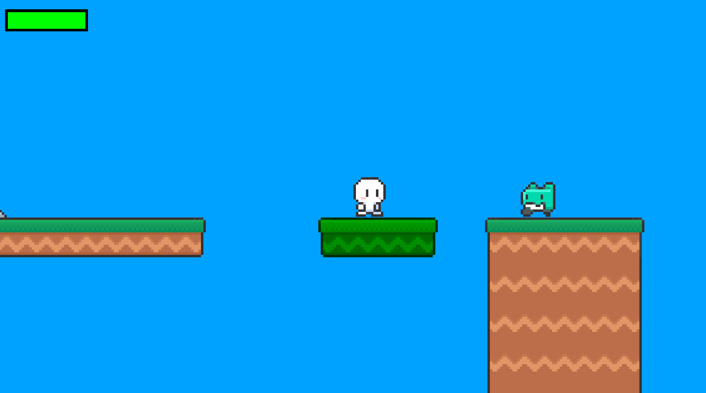
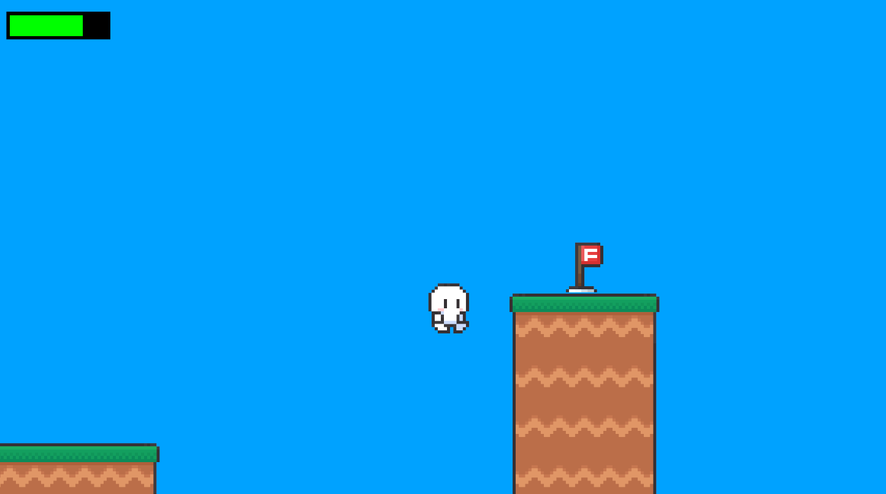
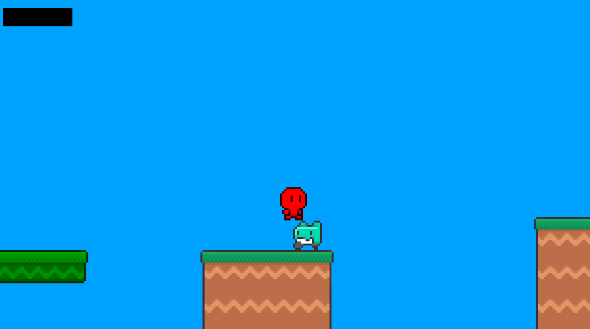

# 2D Platformer

A 2D platformer game built in Unity using C#.

**▶ Play it in your browser:** [devgogia.itch.io/2d-platformer1](https://devgogia.itch.io/2d-platformer1)






## About

A side-scrolling platformer where the player navigates levels, avoids enemies, collects coins, and reaches the end goal to win. Built as a personal project to develop hands-on experience with Unity game development and C# scripting.

## Features

- Player movement and jumping
- Moving platforms
- Enemies with damage mechanics
- Coin collecting system
- Win condition / end goal

## Tech Stack

- **Engine:** Unity
- **Language:** C#

## Getting Started

1. Clone the repo
   ```
   git clone https://github.com/devgogia029/2d-platformer-unity.git
   ```
2. Open the project in Unity 6 (built with 6000.4.1f1)
3. Open the scene from `Assets/Scenes/`
4. Hit Play

## About Me

Aspiring game developer with a focus on Unity and C#. Currently studying BCA at Manipal University Jaipur and building toward a career in game development.

[LinkedIn](https://linkedin.com/in/dev-gogia-242319404/)
